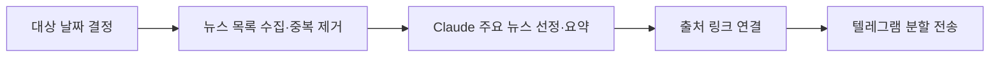

# DNB · 매일 아침 뉴스 브리핑

네이버 뉴스에서 5개 종합일간지(조선일보·중앙일보·동아일보·한겨레·경향신문)의 **전날 하루치 기사 목록**을 수집하고, Claude가 주요 뉴스를 선정·요약해 텔레그램으로 보내는 자동화 프로젝트입니다.

**Python · Claude API · Beautiful Soup · GitHub Actions · Telegram Bot API**

## 주요 구현

| 관심사 | 구현 |
| --- | --- |
| 수집 범위 | KST 대상 날짜의 뉴스 목록을 수집하고 기사 링크 기준으로 중복 제거 |
| 수집 장애 | 페이지 요청 재시도, 반복 페이지 감지, 최대 페이지 수 제한 |
| LLM 처리 | 제목·언론사·시각으로 주요 사안을 선정·요약하고 출처번호를 실제 링크로 변환 |
| 알림 | 긴 메시지를 줄 단위로 분할하고 파이프라인 오류 알림 전송 시도 |
| 자동화 | 매일 KST 06:00 예약 실행, 특정 날짜를 지정한 수동 실행 |

LLM에 전달하는 입력은 **기사 제목·언론사·시각**입니다. 기사 본문을 읽거나 사실관계를 검증하지 않으므로 제목 기반 브리핑으로 사용하고, 세부 내용은 연결된 원문에서 확인합니다.

## 동작 방식



| 파일 | 역할 |
| --- | --- |
| [src/main.py](src/main.py) | 대상 날짜 결정, 수집·요약·알림 연결 |
| [src/collector.py](src/collector.py) | 날짜별 수집, 재시도, 중복 제거 |
| [src/summarizer.py](src/summarizer.py) | LLM 프롬프트와 출처 링크 연결 |
| [src/notifier.py](src/notifier.py) | 알림 분할·전송 |
| [src/config.py](src/config.py) | 수집 대상·모델·시간 제한 설정 |
| [daily-news.yml](.github/workflows/daily-news.yml) | 예약 실행과 날짜 지정 수동 실행 |

기사 수집은 네이버 뉴스 웹페이지(news.naver.com)를 크롤링하는 방식이라 공식 API가 아닙니다. 네이버가 페이지 구조를 바꾸면 크롤러가 깨질 수 있습니다.

GitHub Actions가 매일 UTC 21:00(= KST 06:00)에 자동 실행합니다. GitHub Actions의 scheduled cron은 트리거 자체가 지연될 수 있어(수 분~수십 분이 보통이나 드물게 8시간 이상 지연된 적도 있음) 목표 도착 시각(KST 07시)보다 1시간 앞당겨 설정했습니다.

수집 범위는 **실행 시각이 아니라 대상 날짜**로 정해집니다. 네이버 뉴스 목록의 날짜 파티션을 그대로 창으로 쓰기 때문에, 트리거가 몇 시간 늦게 발화해도 알림에 붙는 날짜와 실제 수집 범위가 어긋나지 않습니다(늦게 오되, 내용은 항상 그 전날 하루치 그대로).

## 사전 준비

### 1. 텔레그램 봇 생성

1. 텔레그램에서 [@BotFather](https://t.me/BotFather) 검색 후 대화 시작
2. `/newbot` 입력 → 봇 이름과 username 설정
3. 발급받은 **봇 토큰**(`123456:ABC-DEF...` 형태) 저장

### 2. chat_id 확인

1. 방금 만든 봇과 텔레그램에서 대화 시작 (아무 메시지나 전송, 예: "안녕")
2. 브라우저에서 아래 주소 접속 (`<TOKEN>`을 실제 봇 토큰으로 교체):
   ```
   https://api.telegram.org/bot<TOKEN>/getUpdates
   ```
3. 응답 JSON에서 `"chat":{"id":123456789, ...}` 의 숫자가 **chat_id**

### 3. Anthropic API 키 발급

[console.anthropic.com](https://console.anthropic.com)에서 API 키 발급.

### 4. GitHub 저장소 생성 및 Secrets 등록

이 프로젝트를 GitHub 저장소로 push한 뒤, 저장소의 **Settings → Secrets and variables → Actions**에서 아래 3개를 등록합니다:

| Secret 이름 | 값 |
|---|---|
| `ANTHROPIC_API_KEY` | Anthropic API 키 |
| `TELEGRAM_BOT_TOKEN` | 텔레그램 봇 토큰 |
| `TELEGRAM_CHAT_ID` | 텔레그램 chat_id |

## 로컬에서 실행하기

워크플로우 기준 Python 3.11을 사용합니다. 저장소 루트에서 실행합니다.

```bash
git clone https://github.com/YJEFFf/DNB.git
cd DNB
python3 -m venv .venv
source .venv/bin/activate
# Windows PowerShell: .venv\Scripts\Activate.ps1
python -m pip install -r requirements.txt

cp .env.example .env
# .env 파일을 열어 실제 키 값 입력

# 1) 크롤링만 확인 (API 키 없이도 실행 가능). 인자로 날짜를 주면 그날을 수집
python -m src.collector
python -m src.collector 2026-08-27

# 2) 전체 파이프라인 실행 (실제로 텔레그램 메시지가 발송됨)
python -m src.main

# 3) 특정 날짜로 다시 실행 (놓친 날 재발송)
TARGET_DATE=2026-08-27 python -m src.main
```

공유용 설정은 [.env.example](.env.example)에 있습니다. 실제 키를 넣는 `.env`는 Git에서 제외됩니다.
위 명령은 수동 실행 안내이며 자동 테스트 통과 기록을 뜻하지 않습니다.

## GitHub Actions에서 수동 실행하기

1. 저장소의 **Actions** 탭 → **Daily News Summary** 워크플로우 선택
2. **Run workflow** 버튼 클릭 → 실행 로그 및 텔레그램 수신 확인

`target_date` 입력란에 `2026-08-27` 같은 날짜를 넣으면 그날치를 다시 요약해 보냅니다(비워두면 전날).

## 뉴스 소스/언론사 커스터마이징

`src/config.py`의 `ALLOWED_OUTLETS`에 원하는 언론사명을 추가/삭제하면 됩니다(네이버 뉴스에 노출되는 언론사명과 정확히 일치해야 함). 크롤링 대상 섹션은 `NAVER_SECTIONS`, 요약에 사용할 모델은 `CLAUDE_MODEL`에서 조정할 수 있습니다. 수집 범위는 항상 대상 날짜 하루 전체이며, 대상 날짜는 `TARGET_DATE` 환경변수로 덮어쓸 수 있습니다.

## 알림 시간 변경하기

`.github/workflows/daily-news.yml`의 `cron` 표현식을 수정하세요. 예를 들어 KST 오전 8시로 바꾸려면 `cron: "0 23 * * *"` (UTC 23:00)로 변경합니다.

> ⚠️ GitHub Actions의 스케줄 cron은 트리거 자체가 지연될 수 있습니다. 보통은 몇 분~몇십 분이지만, GitHub 쪽 스케줄링 큐가 밀리면 몇 시간씩 늦게 실행되기도 합니다(실측 최대 8시간 7분, 러너 배정 이후 작업 실행 속도는 정상). 내용은 지연과 무관하게 전날 하루치로 고정되지만 도착 시각까지 정확해야 한다면, 외부 스케줄러(cron-job.org, Cloudflare Workers Cron 등)에서 `workflow_dispatch` API를 호출하는 방식으로 옮기는 것을 고려하세요.

## 문제 해결

- **아무 메시지도 오지 않을 때**: Actions 탭에서 실행 로그 확인. 대부분 Secrets 값이 잘못 등록된 경우입니다.
- **수집 건수가 0에 가까울 때**: 네이버가 페이지 구조(HTML 클래스명)를 바꿔 크롤러 선택자가 더 이상 맞지 않는 경우일 수 있습니다. `python -m src.collector`로 로컬에서 먼저 확인하세요.
- **로그에 "페이지 상한에서 잘렸습니다" 경고가 보일 때**: 하루 기사량이 늘어 `MAX_PAGES_PER_DATE`를 넘어선 경우입니다. 해당 값을 올리세요(넘어선 만큼 그 섹션의 오래된 기사가 누락됩니다).
